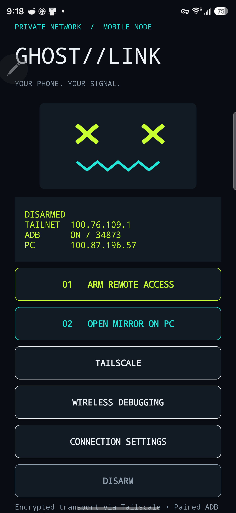
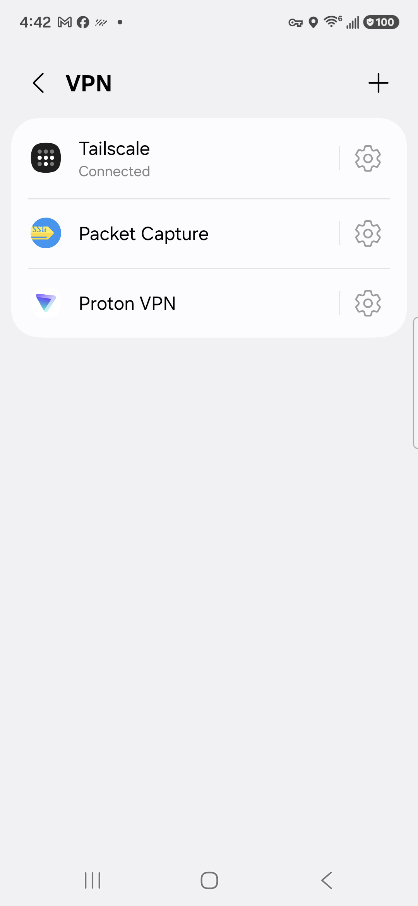

# GHOST//LINK

**Mirror and control your Android phone from Windows over Tailscale. No USB cable, no port forwarding, no public relay, no root.**

GhostLink is a two-part remote mirroring stack: a native Android helper APK and a themed Windows controller that drives `scrcpy` over your private Tailscale network. Tap the phone, the desktop mirror opens. Double-click the desktop, the phone answers. Both directions. Encrypted end to end because the transport never leaves your tailnet.

<p align="center">
  
  
</p>

---

## Why this exists

Every remote-screen tool makes you choose: a cloud relay that sees your screen, a USB cable that defeats the point, or a pile of ADB incantations you re-learn every time the port rotates.

GhostLink removes the choice. It speaks ADB over Tailscale, so the phone and the laptop can sit on completely different networks and still pair once and stay connected. Wireless debugging ports rotate constantly; GhostLink discovers the new port itself and reports it over the authenticated link.

## Features

- **Bidirectional launch.** Phone to PC: tap the home-screen shortcut. PC to phone: double-click the desktop widget.
- **Automatic reconnect.** Failed or closed sessions retry after 3 seconds, backing off to a 60 second ceiling. `END SESSION` stops it. `RECONNECT` starts it again.
- **Three performance profiles.** Travel 1280/30, Balanced 1920/60, Sharp 2560/60. Caps, not promises.
- **Live port discovery.** No more hunting `adb devices` after every reboot.
- **Restart resilience.** The Android helper resumes after boot, unlock, and app updates. The Windows receiver starts quietly at sign-in.
- **Real window translucency.** A glossy glass widget, not a screenshot pretending to be one. Vertical and horizontal layouts, remembered between runs.
- **Always-on-top diamond, hide-to-tray minus, honest quit.** Drag the header to move it.
- **Four themes.** Neon, Cathode, Hacker Green, Spectrum RGB, with orbit effects, scan sweeps, glitch accents, hover outlines and click shockwaves. Effects can be turned off entirely.
- **Disarm means disarm.** It stops the helper and disables wireless debugging when the permission allows.

## Architecture

```
    ┌──────────────────────────┐            ┌───────────────────────────┐
    │  Android helper (APK)    │            │  Windows controller (exe) │
    │  TCP 47831 on tailnet IP │◄──────────►│  TCP 47832 on tailnet IP  │
    └────────────┬─────────────┘            └──────────────┬────────────┘
                 │                                          │
                 │        Tailscale (WireGuard, encrypted)  │
                 └──────────────────┬───────────────────────┘
                                    │
                          scrcpy over paired ADB TLS
```

- Phone helper binds **only** to its Tailscale IPv4 on TCP 47831.
- PC receiver binds **only** to its configured Tailscale IPv4 on TCP 47832.
- Both sides verify the expected peer IP and a random 256-bit controller token.
- Phone endpoints are limited to status and enabling wireless debugging. PC endpoints are limited to showing the launcher and opening the mirror.
- Screen and control traffic ride paired ADB TLS through the tunnel.
- No router port forwarding. No vendor relay. No root. No legacy ADB 5555.

Read [SECURITY.md](SECURITY.md) before you deploy it. The threat model is written down, including what this build does *not* protect against.

## Quick start

**1. Tailscale on both devices.** Same tailnet, both online. The phone needs Wi-Fi, because this backend is built on Android wireless debugging. Cellular-only phones are not supported by this build.

**2. Build or obtain the APK.**

```powershell
# JDK 17 + Android platform 35 + build-tools 35.0.0
.\build-android.ps1
```

The script compiles, dexes, zipaligns, signs and verifies the APK.

**3. Build the Windows controller.**

```powershell
# Python 3.14, PyInstaller and Pillow available
.\build-pc.ps1
```

**4. Create your config.** Copy `config.example.json` to `config.json` and fill it in:

```json
{
  "adb": "tools\\scrcpy\\adb.exe",
  "phone_ip": "100.x.y.z",
  "token": "<64 hex characters, your own random token>",
  "pc_ip": "100.a.b.c",
  "adb_port": 0,
  "scrcpy": "tools\\scrcpy\\scrcpy.exe",
  "device_serial": "<your device serial>"
}
```

**5. Pair once.** Android wireless debugging, pair with code:

```bat
tools\scrcpy\adb.exe pair PHONE_TAILSCALE_IP:PAIRING_PORT
```

Use the port from the pairing dialog, not the connection port. Pairing codes expire.

**6. Run it.** `GhostLink.exe`, then tap **GHOST MIRROR** on the phone or **GHOST MIRROR** on the desktop.

## Do not do this

- **Do not publish your `config.json`.** It contains your controller token, your peers' tailnet addresses and your device serial.
- **Do not publish a personalized APK.** It carries the initial controller token so installation is ready to use.
- **Do not distribute the signing keystore.** Keep `ghostlink.jks` local.
- **Do not run the helper on a public interface.** It refuses non-tailnet binds by design, but do not fight it.

This is a personal build, not a hardened multi-tenant product. Ship your own tokens, your own keystore, your own tailnet.

## Troubleshooting

| Symptom | Cause | Fix |
|---|---|---|
| Phone button does nothing | Windows Firewall blocking inbound 47832 | Allow GhostLink for the Tailscale peer only |
| Mirror fails after reboot | Wireless debugging off | The PC can re-enable it when the helper is online and `WRITE_SECURE_SETTINGS` was granted |
| Connection refused after a network change | Wireless debugging port rotated | Wait for auto-discovery, or enter the current connection port in Connection settings |
| Nothing works, phone on cellular | No Wi-Fi | Not supported by this build |
| Tailscale shows the peer offline | Expired auth or VPN dropped | Re-authenticate Tailscale on the phone |

## FAQ

**Does it need root?** No. It uses Android wireless debugging and a granted privileged permission, not root.

**Does it phone home?** No. There is no vendor relay. The only transport is your Tailscale tunnel.

**Can I use it over the internet?** Yes, that is the point, as long as both devices are on the same tailnet.

**Does it bypass my lock screen?** No. It does not bypass credentials or protected app screens.

**What about multiple PCs?** This version trusts one PC at a time. Pairing is one-time per PC and reusable.

**Why is it not on the Play Store?** It requests privileged permissions and drives ADB. That is a sideload tool by nature.

## Keywords for the lost

Android screen mirroring over Tailscale, scrcpy Windows GUI, wireless ADB without USB, remote phone control over VPN, phone to PC mirroring, PC to phone mirroring, ADB over WireGuard, Tailscale remote Android, headless Android mirroring, scrcpy launcher, Android wireless debugging automation, private screen sharing, no cloud relay screen mirroring.

## Credits and legal

Built on [scrcpy](https://github.com/Genymobile/scrcpy) and [Tailscale](https://tailscale.com). Android wireless debugging documented by [Google](https://developer.android.com/tools/adb#connect-to-a-device-over-wi-fi). Foreground service patterns per [Android docs](https://developer.android.com/develop/background-work/services/fgs/service-types).

Neon mask artwork is original, inspired by hacker-game aesthetics. Not affiliated with, endorsed by, or connected to Watch Dogs, Ubisoft, or any game studio.

## License

MIT. See [LICENSE](LICENSE).
